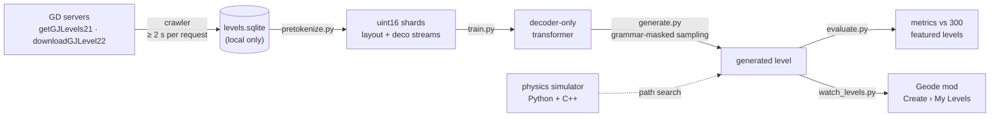

# gd-levelgen

**A transformer that writes Geometry Dash levels token by token.** It is trained on featured levels and uses a
physics simulator during generation, and a Geode mod puts the generated levels into the game.

[](https://www.python.org/)
[](https://pytorch.org/)
[](LICENSE)

[Русская версия](docs/README.ru.md)

---

## Overview

The long-term goal of gd-levelgen is levels that could pass for *featured* Geometry Dash levels. These are the
levels that RobTop Games hand-picks for gameplay and visual quality. The project covers the whole pipeline:

- **Crawler.** A polite, resumable client for the official servers that collects the featured listing (about 36k
  levels).
- **Tokenizer.** It turns a level string into a token sequence and back. The only loss is detail too small to
  see in the game.
- **Model.** A decoder-only transformer (RoPE, GQA, SwiGLU). It writes a level in two passes: first the gameplay
  layout, then the decoration around it. A grammar mask keeps the output well-formed.
- **Physics simulator.** It reimplements GD 2.2081 player physics in Python, plus a matching C++ core that is
  16–30× faster. It searches for a path through a level, so unplayable chunks can be thrown away during
  generation.
- **Evaluation.** It compares generated levels with 300 random featured levels on the same metrics.
- **Geode mod.** It imports generated levels into *Create → My Levels*. It also replays recorded inputs tick by
  tick, which was used to check the simulator against the real game.

Heavy jobs don't run on the local machine. Tokenization, evaluation and diagnostics run on Kaggle kernels, and
the main training run used a Colab GPU worker that gets its jobs from a Kaggle dataset.

> **Status: research prototype.** The pipeline runs end to end, but the generated levels are not
> featured quality yet. See [Results](#results) for an honest picture.

## How it works



1. **Crawl** (`gdgen/crawl.py`, `gdgen/server.py`). The crawler walks the featured listing (`getGJLevels21`,
   `type=6`) page by page and downloads each level with `downloadGJLevel22`. Everything goes into a local SQLite
   store: metadata, the raw server fields as JSON, and the compressed level string. Progress lives in the
   database, so you can kill the process and restart it at any time.
2. **Tokenize** (`gdgen/tokens.py`, `scripts/pretokenize.py`). Each level becomes two aligned token streams:
   - **layout:** the gameplay objects, such as blocks, hazards, orbs, pads, portals and slopes.
   - **deco:** everything else, such as decoration, triggers and coins.

   The streams are written to `uint16` shards.
3. **Train** (`gdgen/model/`, `scripts/train.py`). One model learns both kinds of training window:
   - **Layout windows** hold the gameplay of a level. A sliding window continues after a `<CONT>` token.
   - **Deco windows** hold the decoration of a few segments. The gameplay of the surrounding segments is in
     context, including two segments ahead.
4. **Generate** (`scripts/generate.py`). The model writes the layout first, then decorates it window by window.
   A grammar (`gdgen/model/grammar.py`) masks every next-token distribution, so the output always decodes. With
   `--select-segments K`, the simulator checks the layout every *K* segments. A chunk that can't be passed is
   sampled again, and if no attempt passes, the previous chunk is redone too (backtracking). `BatchDecoder`
   samples many levels at once (continuous batching over a preallocated KV cache).
5. **Evaluate** (`gdgen/evaluate.py`, `scripts/evaluate.py`). Generated levels and a seeded sample of featured
   levels go through the same metrics: object counts per stream, density per segment, gaps, vertical spread,
   hazard, orb and portal counts, triggers, groups, duration, and passability. It also measures the
   Jensen–Shannon distance between the object-ID mixes.
6. **Play** (`replay-mod/`, `scripts/watch_levels.py`). Generated levels are copied into an import folder, and
   the mod turns each one into a local level in a running game.

## Level representation

A level string is `header;object;object;...`. Each object is a list of `key,value` pairs (`1` = object ID,
`2`/`3` = x/y, one grid block = 30 units). The tokenizer sorts objects by position and writes:

```
<BOS> <HEADER> H:kA4 V:1 ... <COLORS> <CHAN> CP:6 V:1000 ... <OBJECTS>
SEG:0 O:1 X:60 Y:0 YF:60 FS:64.67.96 A:21=1004 G:12 ... SEG:1 ... <EOS>
```

- `SEG:s` opens a segment 10 blocks (300 units) wide. It appears only when the segment changes, so every segment
  boundary is a valid start for a training window.
- `X` is the offset inside the segment, in quarter units. `Y` is the block row and `YF` the offset inside it.
- Attributes always come in the same order:
  - flags: a frequent flag set as one `FS:` token, otherwise one `F:` token per flag
  - groups: `G:<id>`
  - other keys: a frequent key/value pair is one `A:k=v` token. Any other key is `K:k` plus value tokens.
- Values: a number that is in the vocabulary becomes `V:<n>`. Other numbers are spelled digit by digit
  (`D:… DEND`), and text is stored as bytes.
- **Conditioning tokens** come after `<BOS>`:
  - level metadata: `M:stars=…`, `M:demon=…`, `M:epic=…`, `M:len=…`
  - music, optionally, after each `SEG` (`gdgen/music.py`): loudness, onset density, bass and beat positions of
    the song during that segment's time span. Time is computed through the speed portals placed so far.
- **Loss.** The round trip loses only detail you can't see in the game:
  - positions are rounded to 0.25 units, angles to 0.1°, and scales to 0.005
  - editor-only keys are dropped

  The contract is `decode(encode(x)) == canonical(x)`. `scripts/token_report.py` checks it on real levels.
- **Vocabulary.** `gdgen/data/vocab_v1.json` holds 63,146 tokens and is fitted by `scripts/fit_vocab.py`. On
  average a gameplay object takes about 9 tokens and a decoration object about 11.

The representation follows the data. In a 400-level sample (`scripts/level_stats.py`), decoration is 73% of all
objects, solids 15%, triggers 5% and hazards 4.6%.

## Model

`gdgen/model/gpt.py` is a decoder-only transformer with these parts:
- RoPE (θ = 500k), RMSNorm and SwiGLU
- grouped-query attention through PyTorch SDPA (FlashAttention on recent GPUs) and tied embeddings
- a chunked cross-entropy, so a 63k vocabulary at 8k context fits in memory

| preset | layers | heads / KV heads | d_model | context |
|---|---|---|---|---|
| `test` | 2 | 4 / 2 | 64 | 512 |
| `s` | 12 | 12 / 4 | 768 | 8192 |
| `m` | 24 | 16 / 4 | 1024 | 8192 |
| `l` | 32 | 20 / 4 | 1280 | 8192 |

`scripts/train.py` supports bf16/fp16, DDP (`torchrun`), gradient checkpointing, `torch.compile`, cosine LR with
warmup, and automatic resume from `<out>/ckpt.pt`.

## Physics simulator

`gdgen/sim/` reimplements the classic-mode player physics of GD 2.2081:
- the step order and the hitboxes
- all eight game modes
- orbs, pads and portals
- slopes, dash orbs, the spider teleport and dual mode
- toggle, move, stop and spawn triggers (rotate, follow, scale, area and keyframe triggers are not simulated)

The Python version is the reference. `gdgen/sim/core/gdsim.cpp` is the same core in C++, which `g++` compiles
automatically on first import. It is 16–30× faster, and `tests/test_fast_sim.py` requires both versions to
produce bit-identical states at every step.

```python
from gdgen.levelstring import decompress, parse_level
from gdgen.sim.level import build_level
from gdgen.sim.fast import FastSimulator

header, objects = parse_level(level_text)
res = FastSimulator(build_level(header, objects)).find_path(max_frontier=256, time_limit=60)
print(res.passed, res.max_x)
```

The simulator was checked tick by tick against traces recorded in the real game with the replay mod (see
[Geode mod](#geode-mod)).

## Results

These numbers come from the first full-size run, **`m1`**. Sources are listed at the end of this section.

### Data and training

- **Training data.** A 2026-10-16 snapshot of the crawl: **10,786 featured levels**, which became about
  **4.33 B tokens** (layout + deco). Tokenization ran on two Kaggle CPU kernels.
- **Model.** Preset `m`: **270.6 M non-embedding parameters (335.3 M total)**, 8,192-token context.
- **Training.** 8,000 steps of 262,144 tokens (≈ 2.1 B tokens) at a peak LR of 3e-4 with cosine decay. It ran in
  bf16 on one RTX PRO 6000 (Blackwell) at about 77k tokens/s and took 7.7 h.

| step | 500 | 1,000 | 2,000 | 4,000 | 6,000 | 8,000 |
|---|---|---|---|---|---|---|
| val loss, layout | 2.914 | 1.249 | 0.766 | 0.613 | 0.552 | **0.527** |
| val loss, deco | 3.688 | 1.694 | 1.151 | 0.999 | 0.923 | **0.892** |

Validation loss was still falling at the end of the run.

### Generated levels vs. featured levels

The `m1` model generated 8 levels with temperature 1.0 and top-p 0.95, without simulator selection. A batch of 8
took 80 minutes on one GPU. Across the 8 levels the grammar-masked decoder produced 1 layout and 24 decoration
decode errors. The table compares these 8 levels with 300 random featured levels. Each cell shows the median,
with the 10th–90th percentile range in brackets:

| metric | featured (n = 300) | m1 (n = 8) | m1 levels inside featured p10–p90 |
|---|---|---|---|
| objects | 28.9k [10.0k – 76.6k] | 9.7k [1.3k – 14.9k] | 50% |
| gameplay objects | 4.69k [1.42k – 14.5k] | 2.24k [594 – 6.58k] | 62% |
| decoration objects | 23.8k [7.2k – 67.6k] | 6.3k [736 – 10.8k] | 50% |
| decoration share | 0.82 [0.64 – 0.93] | 0.65 [0.41 – 0.81] | 38% |
| duration, s | 66.6 [52 – 106] | 71.2 [1.9 – 177] | 38% |
| longest empty gap, units | 334 [119 – 1,590] | 454 [140 – 964] | 88% |
| hazard share of gameplay | 0.236 [0.108 – 0.499] | ≈ 0 [0 – 0.025] | 0% |
| orbs + pads per segment | 0.98 [0.39 – 2.09] | 0 [0 – 0.07] | 0% |
| portals | 55 [17 – 134] | 0 [0 – 1.6] | 0% |
| triggers | 1.2k [304 – 4.09k] | 474 [19 – 2.33k] | 62% |
| simulator finds a path (whole level) | 18% | 86% (6 / 7 simulated) | — |

The Jensen–Shannon distance of the object-ID mix (0 = identical, 1 = disjoint) is 0.70 for gameplay and 0.64 for
decoration.

**What this means.**
- **Plausible scale and structure.** Many `m1` levels fall inside the featured range for size, duration,
  trigger count and empty gaps.
- **Too sparse and too safe.** Decoration density is low, and the gameplay has almost no hazards, orbs, pads or
  portals.
- **Passability doesn't mean quality yet.** The high simulator pass rate comes mostly from these hazard-free
  layouts.

### Simulator diagnostics

`scripts/diag_sim.py` runs on the Kaggle `diag` kernel. It asks why the simulator fails real featured levels,
which are all beatable in the game. On the same 300 reference levels the simulator finds a path through **55
levels (18%)**, or **74 (25%)** when only gameplay objects are kept. Among the failed levels:
- **What kills the player.** 87% of deaths are an object rather than leaving the level bounds: hazards 48%,
  solids 39%.
- **Moving objects.** 33% of the killers are moved by triggers.
- **Transformed objects.** Many killers are scaled (28%), rotated (23%) or hidden (20%).
- **Where it happens.** More than half of the failures happen in the first 10% of the level.

So the simulator is a reliable check for simple, static layouts. It underestimates real levels that rely on
triggers and transformed hitboxes, and closing that gap is the main open task before passability can serve as a
quality signal.

<sub>**Sources.**
- training: the run's `log.jsonl` and `config.json`, and the trainer's startup line
- data size: the logs of the `gd-levelgen-tok-0of2` and `-1of2` Kaggle kernels
- generated levels: the `summary.md` of the `gd-levelgen-eval` kernel on the `m1-gen4` run, and the per-seed
  `report.json` files
- diagnostics: `diag_summary.json` of the `gd-levelgen-diag` kernel

These run artifacts are not part of the repository.</sub>

**Gallery.** No renders are published. `gdgen/render.py` draws levels with the game's own sprites, read from your
local install, so the previews stay on your machine.

## Quickstart

Requirements:
- Python 3.12+ and PyTorch 2.5+
- `g++` for the C++ simulator core (the C++ simulator tests are skipped without it)
- optional: Pillow for renders, librosa and soundfile for song features, and the `kaggle` CLI for remote jobs

```bash
git clone https://github.com/kholkink/gd-levelgen.git && cd gd-levelgen
python -m venv .venv && . .venv/bin/activate
pip install torch numpy requests pytest            # core
pip install pillow librosa soundfile kaggle         # optional extras

python -m pytest -q tests                           # 202 tests, ~2 min on CPU; no data or GPU needed
```

**Crawl** featured levels into `data/levels.sqlite`:

```bash
./crawl start                        # background, resumable; at least 2 s between requests
./crawl status                       # progress (doesn't touch the DB)
./crawl log                          # tail -f the log
./crawl stop                         # graceful stop after the current request
./crawl start --include-platformer   # also download platformer levels (metadata only by default)
python -m gdgen.crawl --max-pages 2  # short foreground test run
```

**Tokenize and train:**

```bash
python scripts/token_report.py --sample 200            # round-trip check + token breakdown
python scripts/pretokenize.py --workers 8              # -> data/tokens/v1/{layout,deco}_NNN.bin + index.jsonl
python scripts/train.py --preset test --ctx 512 --batch 2 --steps 20 --out runs/smoke   # CPU smoke test
python scripts/train.py --data data/tokens/v1 --preset m --ctx 8192 --out runs/m1 --compile
torchrun --nproc_per_node 8 scripts/train.py --data data/tokens/v1 --preset m --out runs/m1
```

**Generate and evaluate:**

```bash
python scripts/generate.py --random-init --out gen/smoke          # pipeline check with an untrained tiny model
python scripts/generate.py --ckpt runs/m1/ckpt.pt --out gen/try1 --stars 8 --epic 1 --length 3
python scripts/generate.py --ckpt runs/m1/ckpt.pt --out gen/m1 --samples 8 --batch 8 --select-segments 4
python scripts/evaluate.py --gen m1='gen/m1/*/level.txt' --ref-db data/levels.sqlite --ref-n 300 \
    --simulate --sim-seconds 60 --workers 4 --out eval/m1
```

Each generated level directory holds these files:
- `level.txt`: the raw level text
- `level_string.txt`: base64 gzip, the form the game stores
- the token streams
- `report.json`: token and object counts, decode errors and the simulator result

## Compute workflow (Kaggle + Colab)

The code and data travel as **private** Kaggle datasets. Kernels are built from templates in `kaggle/kernel.py`.
Your Kaggle username comes from `KAGGLE_USERNAME`, `~/.kaggle/kaggle.json` or `kaggle config view`.

```bash
bash kaggle/push_code.sh                                    # code -> <user>/gd-levelgen-code
bash kaggle/push_levels.sh data/snapshots/levels_X.sqlite   # DB snapshot (VACUUM INTO) -> <user>/gd-levelgen-levels
python kaggle/kernel.py push tok --part 0/2                 # tests + tokenization (CPU), one kernel per part
python kaggle/kernel.py push smoke                          # short training run + generation (T4)
python kaggle/kernel.py push gen --ckpt-dataset gdgen-runs-m1
python kaggle/kernel.py push eval --eval-gen ds:gdgen-runs-m1-gen4
python kaggle/kernel.py push diag                           # why the simulator fails featured levels
python kaggle/kernel.py status eval ; python kaggle/kernel.py output eval   # -> build/kernels/<slug>/out
```

| kernel | what it does |
|---|---|
| `gd-levelgen-tok-<i>of<n>` | runs the tests and tokenizes part *i* of the level snapshot |
| `gd-levelgen-smoke` | runs a short training and generation on a T4 |
| `gd-levelgen-gen` | samples levels from a checkpoint |
| `gd-levelgen-eval` | computes metrics and runs the simulator, generated vs 300 featured levels |
| `gd-levelgen-diag` | finds what kills the simulated player on featured levels |
| `gd-levelgen-songs-<i>of<n>` | computes music features with librosa (the audio is deleted after use) |

**Long training runs** use a Colab worker, `colab/worker.ipynb`. It needs one Colab secret, `KAGGLE_API_TOKEN`.
1. You queue jobs from the local machine. The queue lives in a private dataset:

   ```bash
   python colab/jobs.py add --id m1 --gpu --timeout-h 20 --restore runs/m1 --save runs/m1 --save-every 30 \
       --results '$GD_RUNS/m1/log.jsonl' \
       --cmd '$GD_PY scripts/train.py --data $GD_TOKENS --out $GD_RUNS/m1 --preset m --ctx 8192 --compile'
   python colab/jobs.py status ; python colab/jobs.py logs --id m1
   ```

2. The worker downloads the tokenized shards from the `tok` kernels and runs the jobs.
3. It checkpoints into private `gdgen-runs-*` datasets, so a lost runtime picks the job up where it stopped.

## Geode mod

`replay-mod/` is a small [Geode](https://geode-sdk.org) mod (`gdgen.replay`) for Geometry Dash 2.2081 on
Windows, built against Geode 5.11.1. It has two jobs:

- **Import generated levels.** For every `<dir>/import/<name>.txt` that holds a level string, the mod creates a
  new level `<name>` in *Create → My Levels* while the game is running. It then renames the file to
  `.imported`.
  - `scripts/watch_levels.py` fetches finished levels from a Kaggle kernel or a Colab run and drops them there.
  - Without the mod, `scripts/gd_save.py` writes the levels directly into `CCLocalLevels.dat`. The game must be
    closed for this, and both save files are backed up first.
- **Replay inputs for simulator validation.**
  1. `scripts/make_replay_job.py` writes a `job.txt` with levels and per-tick button presses and releases.
  2. The mod plays the job in the real game at 240 Hz physics and logs the player state on every step to
     `<dir>/out/<name>.csv`.
  3. `scripts/compare_trace.py` compares that log with the simulator's trace, tick by tick.

`<dir>` is `%GDGEN_REPLAY_DIR%`. To build the mod you need the following:
- MSVC 2022 and CMake ≥ 3.21
- the [Geode SDK](https://github.com/geode-sdk/geode), bindings and CLI, set up as `GEODE_SDK` and
  `GEODE_BINDINGS_REPO_PATH`, or placed in `geode/` next to the repo

Build it like this:

```bat
replay-mod\build.bat
rem -> replay-mod\build\gdgen.replay.geode ; copy it into <Geometry Dash>\geode\mods\
```

## Repository layout

| path | contents |
|---|---|
| `gdgen/` | the package: server client, crawler and store, level codec, tokenizer, model, music features, evaluation, renderer, simulator (`sim/`) |
| `gdgen/data/` | the fitted vocabulary and the per-object table for GD 2.2081 (type, hitbox, sprite size) |
| `scripts/` | command-line tools: tokenization, training, generation, evaluation, simulator validation, song features, save-file import |
| `tests/` | pytest suite (codec, tokens, grammar, model, generation, music, simulator, C++ core) |
| `kaggle/`, `colab/` | remote compute: Kaggle kernel builder and dataset uploads; Colab job queue and worker |
| `replay-mod/` | the Geode mod source |
| `re/keys/` | notes on the level format: object key → game field (GD 2.2081) |
| `docs/` | the original Russian README |

Not in the repository:
- crawled levels and the database (`data/`)
- replay jobs, traces and save backups (`replay/`)
- run artifacts (`build/`)
- renders
- the Geode SDK
- any game files

## Data & ethics

- **The levels belong to their creators.** No level data is in this repository:
  - no level strings
  - no crawl database or snapshots
  - no token shards
  - no renders of other people's levels

  The Kaggle datasets used for training are private. The test fixture for the server parser is synthetic.
- **The crawler is polite.**
  - It sends one request at a time, at least 2 s apart (plus random jitter).
  - On HTTP 429 or a Cloudflare challenge it backs off exponentially, from 60 s up to 30 minutes.
  - It pauses for 10 minutes after five "level not found" answers in a row, which looks like a soft block.
  - It's resumable, so nothing is downloaded twice.
  - It uses only the public, read-only endpoints the game itself calls, with no account or login.
- **Music isn't redistributed.** For the optional music conditioning, song audio is downloaded temporarily on a
  Kaggle kernel and deleted right after feature extraction. Only low-dimensional features (loudness, onsets,
  beats) are kept.
- **Please be gentle with the servers** if you run the crawler yourself. Keep the default delay, and don't
  republish other people's levels.

## Disclaimer

This is a fan project, not affiliated with or endorsed by RobTop Games. *Geometry Dash* is a trademark of
RobTop Games AB. The repository contains none of the game's binaries, assets or code. The simulator is an
independent reimplementation of the game's behaviour, and the renderer and the mod need your own copy of the game.
Geode is a separate project by the Geode team.

## License

[MIT](LICENSE) © 2026 NoJokes (kholkink). The license covers the code in this repository. It does not cover
Geometry Dash, its assets, or levels made by other players.
